# 原厂软件功能说明（In-Vision 8.2 / 汉特士）

> **来源**：现场提供的 `软件功能说明.rar`（16 张界面截图，2026-11-16 导入到本仓库 `docs/软件功能说明/`）。
> **性质**：原厂**没有文字版说明书**（无源码、无手册），本文件是**照截图逐屏整理出的功能清单**，作为功能对齐与验收的依据。
> **不确定的地方已标注「待确认」**，不要当官方规格用。
> 配合 [`功能差距.md`](功能差距.md)（差距项 D-xx）与 [`ARCH.md`](../ARCH.md)（架构决策）使用。
>
> **另一份必读**：[`现场实操需求.md`](现场实操需求.md) —— 调机师傅的**实际操作 4 步流程 + R-01~R-22 必须项**。
> 本文回答"界面长什么样"，那份回答"现场怎么用、哪些不能少"；**两者冲突时以现场实操为准**。

---

## 0. 软件结构总览

主界面 = 菜单栏 + 工具栏 + **左侧「任务导航」** + **中间多相机画面（2×2 停靠窗口）** + **右侧「检测设置」停靠面板**（底部 4 个页签）+ 状态栏。

| 区域 | 内容 |
| --- | --- |
| 菜单栏 | 文件(F) / 编辑(E) / 绘制(D) / 视图(V) / 系统(S) / 窗口(W) / 帮助(H) |
| 左侧任务导航 | 「检测数据获取」（连接相机、相机1…4）、「检测参数设置」、「IO参数控制」、最后一步「完成」 |
| 中间 | 相机1…相机4 四个可停靠/浮动窗口，标题栏带最小化/最大化/关闭 |
| 右侧 | 检测设置（默认页签）/ 规则设置 / 规则预览 / 检测结果 |
| 状态栏 | 当前像素坐标 `X:1833 Y:815`、通道值 `R/G/B`、耗时等 |

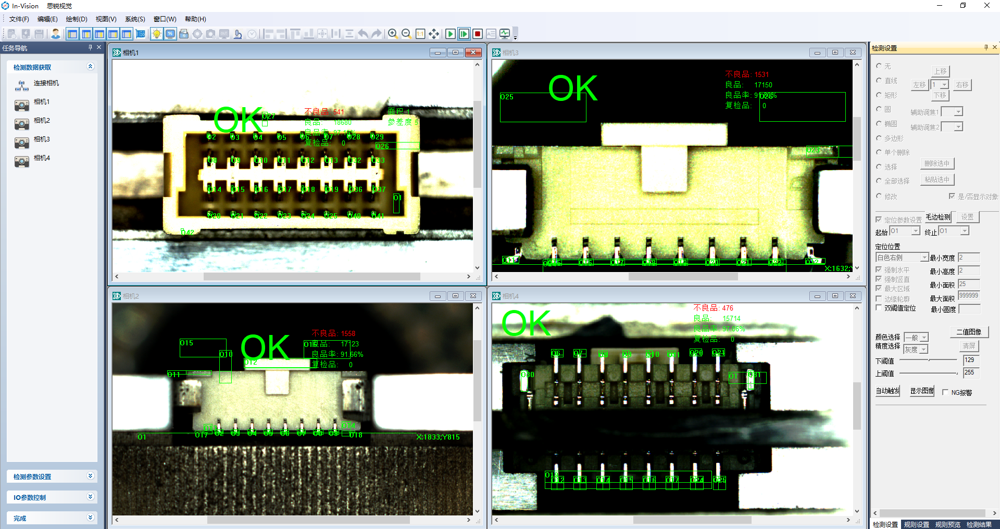

> 现场实拍补充（4 路画面，OK 标注）：`软件功能说明/实操-4画面OK.jpg`、`软件功能说明/实操-4画面空载.jpg`。
>
> **从调试员实拍能看出的两点（2026-11-16）**：
> 1. 4 路是 **MDI 浮动子窗口**（可拖动、可重叠、各自标题栏 + 最小化/最大化/关闭），不是固定网格；
> 2. 单路画面里 **10~16 个检测对象**，编号（01、02…）贴在每个框旁，字号很小 → 标注必须可读、可只显示编号。
> 3. 相机1 有一条**横线贯穿整排 PIN**，疑似基准线 + 各点在线上的取点。

---

## 1. 菜单栏

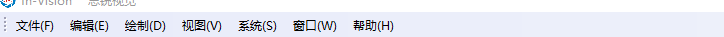

### 1.1 文件(F)

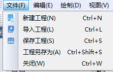

| 菜单项 | 快捷键 | 说明 | VisionApp 对应 |
| --- | --- | --- | --- |
| 新建工程 | Ctrl+N | 新建检测工程 | ✅ 新建配方 |
| 导入工程 | Ctrl+L | 打开已有工程（.HPro） | ✅ 打开配方 / 导入 .HPro |
| 保存工程 | Ctrl+S | 保存 | ✅ 保存 |
| 工程另存为 | Ctrl+Shift+S | 另存 | ✅ 另存为 |
| 关闭 | Ctrl+W | 关闭工程 | 部分（无工程概念，直接关窗口） |

> 现场补充（R-17）：文件菜单还要管**导出检测记录**——我们目前只有 CSV 落盘。

### 1.2 编辑(E)

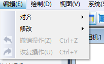

- **对齐**（子菜单）、**修改**（子菜单）、**撤销操作** Ctrl+Z、**恢复操作** Ctrl+Y。
- 现场用法（R-07）：多选后在这里做**上/下/左/右对齐、等大小、水平/垂直等间距**。
- **VisionApp 现状**：无撤销/重做、无多选批量（D-28 / D-30）。

### 1.3 视图(V)

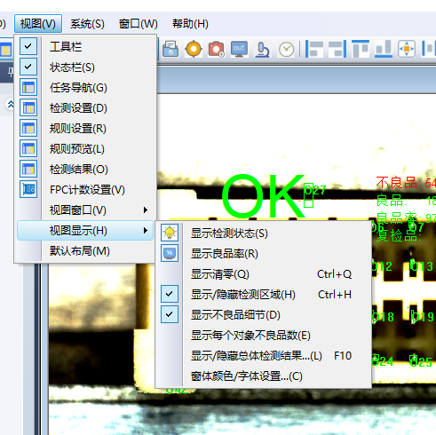

- 面板开关：工具栏 / 状态栏 / 任务导航 / **检测设置** / **规则设置** / **规则预览** / **检测结果** / **FPC计数设置** / 视图窗口。
- 「视图显示(H)」子菜单：
  - 显示检测状态(S)、显示良品率(R)、**显示清零(Q) Ctrl+Q**
  - **显示/隐藏检测区域(H) Ctrl+H**
  - 显示不良品细节(D)、**显示每个对象不良品数(E)**
  - **显示/隐藏总体检测结果(L) F10**
  - **窗体颜色/字体设置(C)**
- 意义：显示层高度可配置（颜色、字号、良品率位置、区域显隐）→ D-16。

### 1.4 系统(S)（主控菜单，信息量最大）

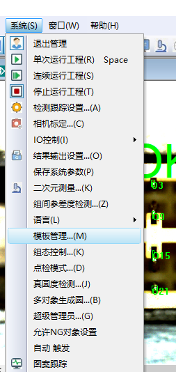

| 分组 | 菜单项 | 说明 | VisionApp 现状 |
| --- | --- | --- | --- |
| 运行 | 退出管理 | 退出（可能要权限） | 部分 |
| 运行 | **单次运行工程**(R) `Space` | 单次触发跑一帧 | ✅ 单次模式 |
| 运行 | **连续运行工程**(S) | 循环跑 | ✅ 连续模式 |
| 运行 | **停止运行工程**(T) | 停止 | ✅ 停止 |
| 配置 | 检测跟踪设置…(A) | 跟踪/记录设置（**待确认**） | 部分（记录设置） |
| 配置 | **相机标定…**(C) | 像素↔毫米标定（X 水平 / Y 垂直，值可直接改） | ⚠️ 仅两点标定单一比例（D-34） |
| 配置 | IO控制(I) ▸ | IO 端口与信号 | ❌ 无（D-08） |
| 配置 | **结果输出设置…**(O) | 串口/输出协议 | ✅ 输出/报警 |
| 配置 | **保存系统参数**(P) | 保存全局参数（`HunterxSys.ini`） | 部分（app_settings.json，D-35） |
| 测量 | **二次元测量…**(K) | 独立测量工具 | ❌ 无（D-18） |
| 测量 | **组间参差度检测…**(Z) | 组与组之间参差度 | ❌ 无（D-04/D-26） |
| 通用 | 语言(L) ▸ | 中/英 | ❌ 仅中文（D-17） |
| 通用 | **模板管理…**(M) | 多模板/附属模板管理 | ❌ 无（D-10） |
| 通用 | 组态控制…(K) | 与组态软件通讯（**待确认**） | ❌ 有意不做（功能差距 §3） |
| 模式 | **点检模式…**(D) | 定期点检（偏差/极差/平均值） | ❌ 无（D-12） |
| 模式 | **真圆度检测…**(J) | 圆心度/真圆度 | ❌ 无（D-04） |
| 模式 | **多对象生成圆…**(B) | 多目标拟合圆 | ❌ 无（D-04） |
| 权限 | **超级管理员…**(G) | 密码 + 序列号 + 相机/信号/命名设置 | 部分（D-15，需三级权限） |
| 权限 | **允许NG对象设置** | 指定对象允许 NG 不报警 | ❌ 无（D-24） |
| 触发 | **自动触发** | 连续自动触发（不依赖外部信号） | ✅ 连续模式 |
| 稳定 | **图案跟踪** | **已确认为「跟踪框」**：补偿产品放料位置偏差，配合「跟踪设置」使用（R-14/R-15） | ❌ 无（**D-33，P0 最高**） |

### 1.5 窗口(W)

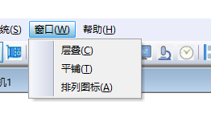

- 层叠(C) / 平铺(T) / 排列图标(A) —— 多相机窗口的排布方式（D-16 / R-19）。

---

## 2. 任务导航 + 相机设置

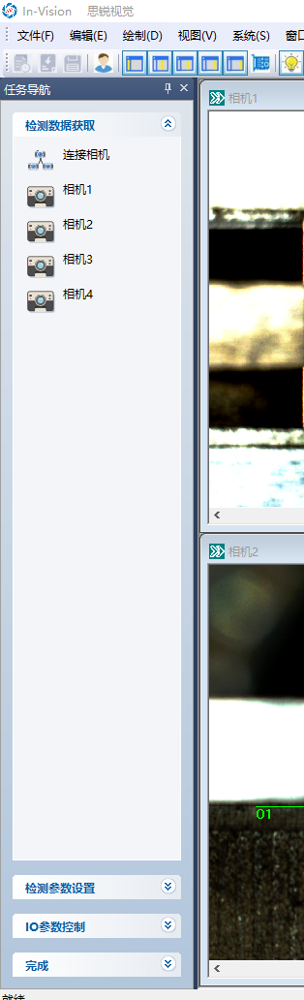

- 左侧树：**连接相机** → 相机1/2/3/4（点一下连一台）→ 检测参数设置 → IO 参数控制 → 完成（向导式流程）。
- 相机窗口可停靠、可浮动，2×2 默认布局。

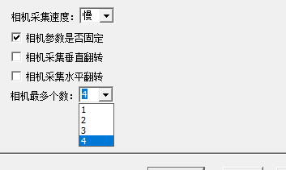

| 项 | 取值 | 说明 |
| --- | --- | --- |
| 相机采集速度 | 慢（可下拉） | 全局采集节奏 |
| 相机参数是否固定 | 勾选 | 相机参数锁定，不让自动曝光乱跳 |
| 相机采集垂直翻转 / 水平翻转 | 勾选 | 装反了不用拆相机 |
| 相机最多个数 | 1 / 2 / 3 / **4** | 原厂最多 4 路 |

> VisionApp：6 机位、每机位独立相机/配方；**缺**翻转、采集速度、参数锁定（D-02）。
> 现场还要求**曝光/增益/帧率/触发模式**可调（R-03，必须）。

---

## 3. 检测设置（右侧面板，页签 1/4）

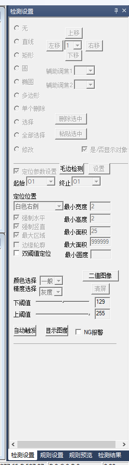

> 现场视频截帧（更清晰，实测值）：`软件功能说明/视频-检测设置面板.png`、`软件功能说明/视频-检测结果表.png`、`软件功能说明/视频-画面统计块.png`、`软件功能说明/视频-主界面全图.png`

### 3.1 ROI 类型与编辑

| 控件 | 说明 |
| --- | --- |
| 无 / **直线** / 矩形 / 圆 / 椭圆 / 多边形 | 6 种 ROI 形状；原厂"直线"强制水平向右延伸。**现场确认：画线功能要保留、且要能任意角度**（只去掉强制水平，改为 Shift 吸附）→ R-04/D-29 P0 |
| 圆 / 椭圆旁的 `辅助圆角1 / 辅助圆角2` 下拉 | 圆/椭圆找圆时的辅助参数（语义**待确认**） |
| 单个删除 / 选择 / 全部选择 / 修改 | 对象批量操作（R-06：矩形 + Ctrl 可连画多个） |
| 上移 / 下移 / 左移 / 右移 | 微调位置（1 px 步进） |
| 是否显示对象 | 显隐 ROI 框 |

> VisionApp：只有**矩形 ROI**（`Rect`）；线形 ROI 缺（D-29，P0）、多选批量对齐缺（D-30）、其余形状缺（D-25）。

### 3.2 定位参数设置 / 毛边检测

- 「定位参数设置」勾选 + 「毛边检测」页签 + 「设置」。
- 起始 01 / 终止 01（对象编号区间）。

> 毛边检测 = 边缘毛刺/毛边判定，VisionApp 无（D-04）；「定位参数/跟踪」相关见 D-33。

### 3.3 定位位置（抓取位置）

| 控件 | 取值示例 |
| --- | --- |
| 定位方式（抓取位置） | **白色中上**（视频实测值；下拉里另有黑色底部 / 白色底部 / 白色中下 / 黑色中下…，R-08） |
| 强制水平 / 强制竖直 | 勾选 |
| 最大区域 / 边缘轮廓 / 双阈值定位 | 勾选 |
| **最小**宽度 / **最小**高度 / 最小面积 / 最大面积 / 最小圆度 | `2 / 2 / 25 / 999999 / —`（视频实测，R-08） |

> 对应 VisionApp `find_blobs` 的 `threshold_mode/threshold/blur/morph/min_area/max_area`；
> **缺**抓取方向（黑白×区位）、双阈值、强制水平/竖直、最小圆度（D-31/D-25）。

### 3.4 颜色与精度

- 颜色选择：**一般**（另有彩色等）；精度选择：**灰度**（另有彩色/二值）。
- 下阈值 / 上阈值：滑条 + 数字框（静态截图是 `129 / 255`，**视频里现场改成 `111 / 255`**）。
- **现场约束（R-09）**：阈值 0~255，**可用上限 254**；调到 0 或 255 会抓取错误。
- 「二值图像」按钮 = 预览二值结果；「清屏」清画面；**红色范围 = 阈值调节后被屏蔽掉的区域**（R-10）。

### 3.5 运行时开关

- **自动触发** / **显示图像** / **NG报警**（本机位是否响铃）。

---

## 4. 规则设置（右侧面板，页签 2/4）

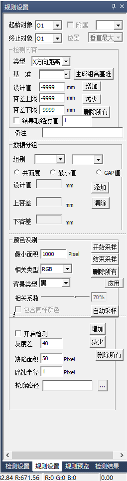

### 4.1 对象区间与位置

- 起始对象 `01` / 终止对象 `01`；位置 / 附属（下拉）；**垂直最大**。
- **视频2 实测（t=300s）**：起始/终止 = `04 / 04`；位置 = `垂直最大`（灰显）；类型 = `X方向距离`；
  设计值 `1` mm、容差 `±0.08` mm；颜色识别 最小面积 1000 / RGB / 背景黑 / 相关系数 70%；
  缺陷检测未启用（灰度差 40、缺陷面积 50、腐蚀半径 1）。截图见 `软件功能说明/视频2-规则设置真值.png`。

### 4.2 检测内容

| 控件 | 说明 |
| --- | --- |
| 类型 | **X方向距离**（下拉；现场：**X 水平、Y 垂直**；间距=X方向距离，贴板=Y方向距离，R-11） |
| 基准 | 基准对象（下拉），另一项「**生成组合基准**」= 用多个对象组合出基准；**视频2 实测 = `03`**（对象 04 相对 03 测距） |
| 设计值 | `9999` mm（名义值，实测与它比较）；**视频2 实测值 = `1` mm** |
| 容差上限 / 容差下限 | `-9999 / -9999`（相对设计值的上/下容差）；**视频2 实测 = `+0.08 / -0.08` mm** |
| 结果取绝对值 | 勾选（距离方向不敏感） |
| 增加 / 减少 / 删除所有 | 规则项管理 |
| 备注 | 自由文本 |

> 对应 VisionApp 的 `judge: range/upper/lower`；**缺** 设计值+容差的表达方式、组合基准、绝对值开关（D-05/D-26）。
> 现场补充（R-12）：设好规则要能在**规则预览**里一屏看到全部规则（D-32）。

### 4.3 数据分组（组别统计）

- 组别下拉 ×2；**共面度** / **最小值** / **最大值**；**GAPI值**（待确认，疑为 Gap/间隙值）。
- 设计值、上容差、下容差；添加 / 清除。

> 意义：把多个对象按组汇总（共面度、组内极差、最大/最小），VisionApp 无（D-26）。

### 4.4 颜色识别（相似度类检测）

- 最小面积 `1000` Pixel；相关类型 `RGB`；背景类型 `黑`；**相关系数 70%**；自动采样 / **开始采样** / 结束采样 / 删除所有 / 应用；「包含同样颜色」。

> 这是「颜色/模板相似度」检测，对应 VisionApp `match_template` 的 `min_score`（部分，D-04 相似度）。

### 4.5 缺陷检测（需勾选「开启检测」）

- 灰度差 `40`、缺陷面积 `50` Pixel、腐蚀半径 `1` Pixel、**轮廓路径**（文件）。
- 增加 / 减少 / 删除所有。

> 缺陷/脏污类检测，VisionApp 无（D-04）。

---

## 5. 检测结果（右侧面板，页签 4/4）

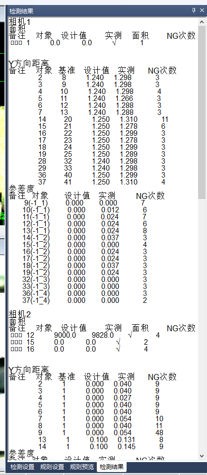

- 按机位分组：`相机1` / `相机2`… 每组按项目类型再分小节（**面积**、**X方向距离**、**参差度**…）。
- 画面上另有一块统计：`不良品 / 良品 / 良品率 / 复检品`（每路相机右上角），对象带编号 → R-23 / D-37。
- 列：`备注 / 对象 / 基准 / 设计值 / 实测 / 面积 / NG次数 / √`（√ = 该项合格）。
- 每项累计 **NG次数**（同一对象历史 NG 计数），便于定位高频不良位。

> VisionApp：有每帧结果表 + CSV，**缺** 逐对象明细、NG 次数累计、设计值对照、合格勾选列（D-27）。

---

## 6. 超级管理员

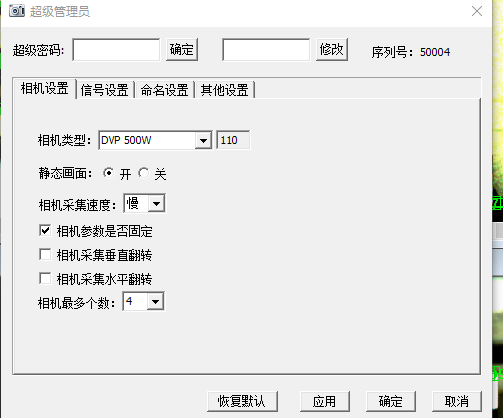

| 控件 | 说明 |
| --- | --- |
| 超级密码 | 输入 + **确定**；另有输入框 + **修改**（改密码） |
| **序列号 50004** | 机器/授权序列号（原厂走 HASP/机器码授权） |
| 页签 | **相机设置** / **信号设置** / **命名设置** / **其他设置** |
| 相机类型 | 下拉选择具体厂商/型号（见下） |
| 静态画面 | 开 / 关（不接相机时用静态图调试） |
| 相机采集速度 | 慢 |
| 相机参数是否固定 | 勾选 |
| 相机采集垂直/水平翻转 | 勾选 |
| 相机最多个数 | 1~4 |
| 底部按钮 | 恢复默认 / 应用 / 确定 / 取消 |

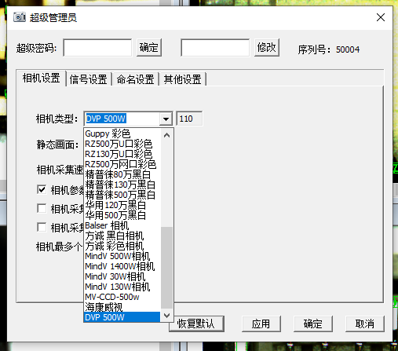

**原厂支持的相机型号（下拉原文）**：

| # | 型号 | 备注 |
| --- | --- | --- |
| 1 | Guppy 彩色 | AVT/Allied Vision |
| 2 | R2500万口彩色 | 2500 万，USB 口 |
| 3 | R2130万口彩色 | 2130 万，USB 口 |
| 4 | R2500万网口彩色 | 2500 万，千兆网口 |
| 5 | 精普徕80万黑白 | |
| 6 | 精普徕130万黑白 | |
| 7 | 精普徕500万黑白 | |
| 8 | 华用120万黑白 | |
| 9 | 华用500万黑白 | |
| 10 | Basler相机 | 巴斯勒 |
| 11 | 方诚黑白相机 | |
| 12 | 方诚彩色相机 | |
| 13 | MindV 500W相机 | 迈德威视 |
| 14 | MindV 1400W相机 | |
| 15 | MindV 30W相机 | |
| 16 | MindV 130W相机 | |
| 17 | MV-CCD-500w | |
| 18 | 海康威视 | HIKROBOT / MVS |
| 19 | DVP 500W | DVP（待确认厂商） |

> 对我们的意义：**现场实际型号必须确认**（D-01 优先级 P0，R-02）。列表里出现的是海康、Basler、MindVision 三类主流 SDK + 若干国产相机。
> **信号设置 / 命名设置 / 其他设置** 三个页签截图缺失 → **待补**（见 §8）。

---

## 7. 与 VisionApp 的对应关系

| 原厂功能 | VisionApp 实现 | 状态 | 差距项 |
| --- | --- | --- | --- |
| 工程 新建/导入/保存/另存 | 配方 JSON + .HPro 导入 | ✅ 对齐 | D-05 |
| 单次 / 连续 / 停止运行 | `MODE_SINGLE` / `MODE_CONTINUOUS` | ✅ 对齐 | — |
| 自动触发（软件连续） | 连续模式 | ✅ 对齐 | — |
| 相机标定（X/Y 可直接改） | 两点标定单一 `mm_per_px` | ⚠️ 部分 | **D-34** |
| 结果输出设置 | 串口/TCP/文件 + 模板 | ✅ 可用 | D-07/D-09 |
| 相机型号列表（19 种） | synthetic/folder/uvc/rtsp | ❌ 缺失 | **D-01 P0** |
| 相机参数（曝光/增益/帧率/触发模式/翻转） | 无 | ❌ 缺失 | D-02 |
| 4 路相机 / 6 机位同屏 | 6 机位 + 合并判定 | ✅ 超过原厂 | D-13 |
| ROI：直线/矩形/圆/椭圆/多边形 | 仅矩形 | ❌ 部分 | **D-29**（直线）+ D-25（其余形状） |
| 直线（线形 ROI，任意角度） | 无（仅矩形） | ❌ 缺失 | **D-29（P0）** |
| 多选 + 批量对齐/等大小/等间距 | 无 | ❌ 缺失 | **D-30** |
| 二值预览 / 双阈值 / 清屏 | 无（单阈值） | ❌ 部分 | D-25 |
| 抓取位置（黑白×区位）+ 阈值 1~254 + 屏蔽区红色 | 仅明暗极性 | ❌ 部分 | **D-31** |
| 毛边检测 | 无 | ❌ 缺失 | D-04 |
| 规则：设计值 + 上下容差 + 绝对值 + 组合基准 | 上下限/区间 | ⚠️ 表达不同 | D-05/D-26 |
| 数据分组（共面度/极值/GAPI） | 无 | ❌ 缺失 | D-26 |
| 颜色识别 + 相关系数 | `match_template` min_score | ⚠️ 部分 | D-04 |
| 缺陷检测（灰度差/面积/腐蚀/轮廓） | 无 | ❌ 缺失 | D-04 |
| 规则预览总览 | 无（仅逐项列表） | ⚠️ 部分 | **D-32** |
| 检测结果逐对象明细 + NG次数 | CSV + 结果表 | ⚠️ 部分 | D-27 |
| 画面统计块（含**复检品**）+ 对象编号 | 有 OK/NG/良率，缺复检品与编号 | ⚠️ 部分 | **D-37** |
| 有无/尺寸/缺料 判定类型 | 算子可覆盖，界面未体现 | ⚠️ 部分 | **D-39** |
| **跟踪框 + 跟踪设置** | 无 | ❌ 缺失 | **D-33（P0 最高）** |
| 超级管理员（密码/序列号/相机页签） | 操作员/工程师 SHA-256 | ⚠️ 部分（授权不做） | D-15 / ADR-011 |
| 三级权限（生产/管理员/超级） | 两级且默认全权限 | ⚠️ 相反 | **D-15** |
| 视图显示定制（颜色字号/良品率位置/区域显隐） | 固定样式 | ❌ 缺失 | D-16 |
| 撤销/重做、对齐、批量修改 | 无 | ❌ 缺失 | D-28 / D-30 |
| 系统设置（日志路径/自动保存/版本/外部信号） | 部分（记录/输出/报警） | ⚠️ 部分 | D-03 / D-35 |
| 工具栏 抓拍原图/保存截图/清除结果/一键运行 | 部分（启停/单帧） | ⚠️ 部分 | D-36 |
| 二次元测量 / 点检 / 真圆度 / 多对象生成圆 / 模板管理 / 组间参差 | 无 | ❌ 缺失 | D-18 / D-12 / D-04 / D-10 |
| 允许 NG 对象设置 | 无 | ❌ 缺失 | D-24 |

---

## 8. 待确认 / 待补

| # | 事项 | 需要什么 |
| --- | --- | --- |
| 1 | 超级管理员的**信号设置 / 命名设置 / 其他设置** 三页内容 | 补截图 |
| 2 | `检测跟踪设置`、`组态控制`、`GAPI值` 的确切语义（`图案跟踪` 已确认为跟踪框） | 补截图或现场演示 |
| 3 | 工具栏各按钮功能（`工具栏7.png` 只截到一条，看不清） | 补截图 |
| 4 | 「定位方式 / 抓取位置」下拉的**完整枚举**（黑/白 × 底/中下/中/上/左/右？） | 补截图 |
| 5 | 现场**实际相机型号**、IO 卡型号、PLC 通讯协议 | 现场核对（D-01/D-08/D-09） |
| 6 | 规则类型的完整下拉（X方向距离 之外还有哪些） | 补截图，用于 `.HPro` type 号映射（D-05） |
| 7 | 「贴板」是否就是 Y 方向两点间距 | 现场确认（R-11） |

---

## 9. 截图索引

| 文件 | 内容 |
| --- | --- |
| `主界面1.png` | 软件整体布局（4 相机 + 左导航 + 右检测设置 + 状态栏） |
| `菜单栏.png` | 7 个主菜单 |
| `文件菜单.png` | 新建/导入/保存/另存为/关闭 |
| `编辑菜单.png` | 对齐/修改/撤销/恢复 |
| `视图菜单.png` | 面板开关 + 视图显示子项 |
| `系统菜单.png` | 运行控制/配置/测量/模式/权限/触发 |
| `窗口菜单.png` | 层叠/平铺/排列图标 |
| `相机设置2.png` | 左侧任务导航 + 相机列表 |
| `相机数量选择.png` | 采集速度/参数锁定/翻转/相机数 |
| `相机显示画面3.png` | 4 路相机画面 + OK 大字 + 不良品/良品/良品率/复检品 |
| `检测框检测规则相机检测结果显示4.png` | 检测设置面板（ROI/定位/阈值/触发） |
| `规则设置5.png` | 规则设置面板（设计值/容差/分组/颜色识别/缺陷） |
| `检测结果6.png` | 检测结果明细（逐对象/NG次数） |
| `超级管理员界面.png` | 超级密码 + 相机设置页签 |
| `选择相机、.png` | 相机型号下拉全清单 |
| `工具栏7.png` | 工具栏（截图不全，需补） |
| `实操-4画面OK.jpg` | 现场实拍：4 路画面跑出 OK |
| `实操-4画面空载.jpg` | 现场实拍：未接相机的 4 分屏布局 |
